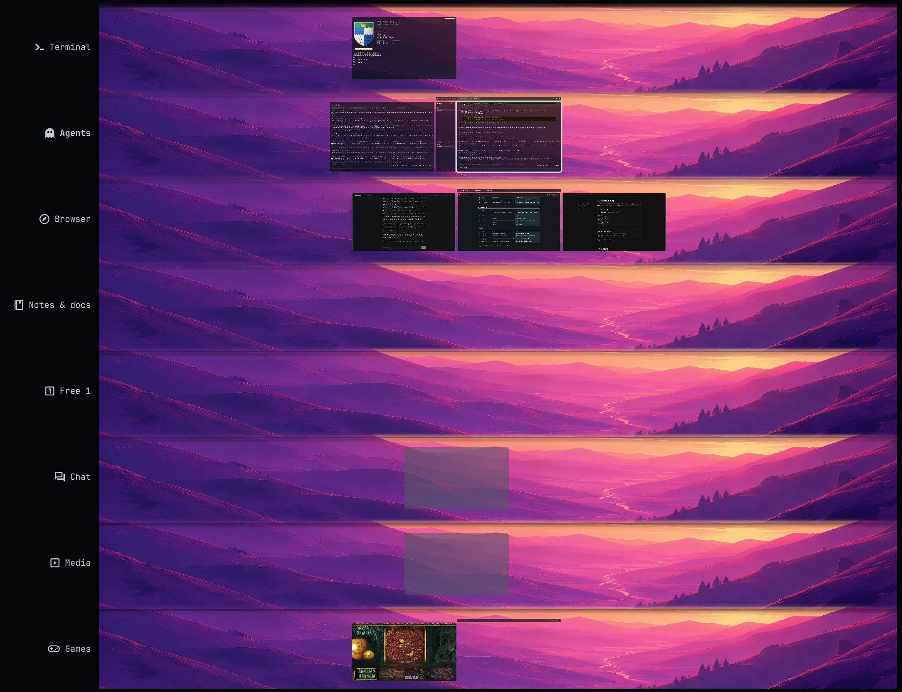

# Strata

A 2D workspace grid for [Omarchy](https://omarchy.org) and Hyprland.

Each workspace is a **stratum**, and the strata stack top to bottom on one shared horizontal axis.
Moving up or down keeps your exact horizontal position, columns sit wherever you put them (with empty space between windows if you like), and the view moves independently of keyboard focus.
Strata have names, icons, hotkeys, app routing rules, profiles, themes and wallpapers.



- **Grid navigation**: SUPER+arrows move along a row and between strata; windows step through empty space, stack into and pop out of columns.
- **Overview** (SUPER+TAB): every stratum zoomed out at once, with keyboard navigation, search, and drag-and-drop to move, stack and resize windows across strata.
- **Preview cross**: live thumbnails of the neighbouring areas while you navigate.
- **Routing**: apps open on their stratum (by app category, installed app, window class or title), and moves you make are offered as rules.
- **Per-stratum themes and wallpapers**, switched as you move, plus picture-in-picture for video players when you leave a stratum.

Full documentation: **https://reflectionist.github.io/omarchy-strata/**

## Requirements

- Omarchy 4 with Hyprland 0.56 or newer (Lua configuration)
- Build tools for the bundled Hyprland plugin: `gcc`, `make`, `pkgconf` (Omarchy installs them), and `jq`

Strata includes a native Hyprland layout plugin (C++). It is built on your machine from the source in `native/`; no binaries are downloaded.

## Quickstart

1. Add the plugin:

   ```bash
   omarchy plugin add https://github.com/Reflectionist/omarchy-strata --enable
   ```

   Its icon appears at the left of the bar.

2. Click the icon, open **Setup** and choose **Connect**. A terminal builds the Hyprland plugin (about a minute) and asks before each change to your configuration:
   - one line at the end of `~/.config/hypr/hyprland.lua` (backed up first),
   - optionally, an Omarchy hook that rebuilds the plugin after Hyprland updates,
   - optionally, an Omarchy hook that saves themes picked with Omarchy's theme picker to the current stratum.

   The same steps from a terminal:

   ```bash
   ~/.config/omarchy/plugins/io.github.reflectionist.strata/bin/strata-setup
   ```

3. Optional: in **Setup**, choose **Route open windows** to move windows that are already open to their strata.

## Keys

| Keys | Action |
|---|---|
| SUPER+LEFT/RIGHT | Focus the next window, or move through empty space |
| SUPER+UP/DOWN | Focus up or down a column, then the stratum above or below |
| SUPER+SHIFT+LEFT/RIGHT | Move the window; stacks into or pops out of a column it touches |
| SUPER+SHIFT+UP/DOWN | Move the window up or down a column, then to the stratum above or below |
| SUPER+CTRL+SHIFT+LEFT/RIGHT | Move the window by the fine step |
| SUPER+1…9 | Go to a stratum (SHIFT: move the window there) |
| SUPER+TAB | Overview (SUPER+SHIFT+TAB: overview with search) |
| SUPER+RETURN | Launch the current stratum's app |

These replace Omarchy's bindings for the same keys. Each group can be handed back to Omarchy in **Settings › Navigation › Key bindings**.
The [usage guide](https://reflectionist.github.io/omarchy-strata/usage) covers the mouse, touchpad and overview controls.

## Settings

Click the bar icon. Settings are saved to `~/.config/strata/strata.json`, which holds only what you change; everything else comes from [`config/defaults.json`](config/defaults.json).

## Updating

```bash
omarchy plugin update io.github.reflectionist.strata
```

If the update changed the Hyprland plugin, **Setup** shows it as out of date: choose **Rebuild**. With the post-update hook enabled, Omarchy updates that change Hyprland rebuild it automatically.

## Removal

1. In **Setup**, choose **Disconnect**, or run `bin/strata-setup --remove` (add `--purge` to also delete your Strata settings). This removes the `hyprland.lua` line, the hooks and the built plugin, and Hyprland returns to its own layout.
2. Remove the shell plugin:

   ```bash
   omarchy plugin remove io.github.reflectionist.strata
   ```

## License

[MIT](LICENSE)
