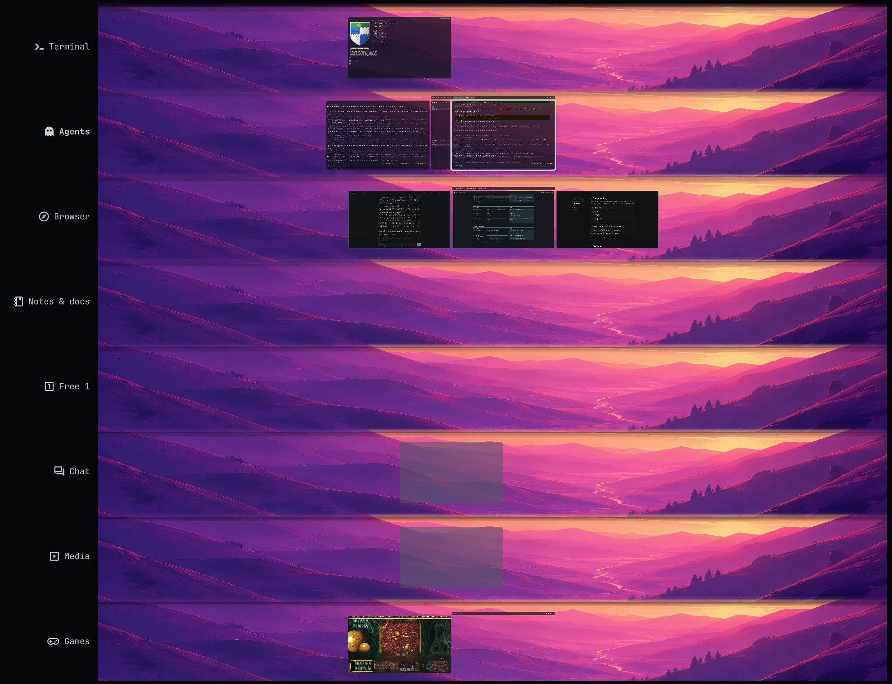

# Strata

A 2D workspace grid for Omarchy and Hyprland.
{: .fs-6 .fw-300 }

[Install](install){: .btn .btn-primary .mr-2 } [Strata on GitHub](https://github.com/Reflectionist/omarchy-strata){: .btn }

## Concepts

**Stratum.** One workspace with a name, an icon, a hotkey and its own settings. The strata are stacked top to bottom in an order you choose; SUPER+UP/DOWN moves between neighbours.

**One horizontal axis.** Every stratum shares the same horizontal coordinate. Positions are measured in screen widths: a column at 1.5 is one and a half screens to the right of 0 on every stratum. Moving to the stratum above or below keeps your horizontal position, so related windows can be lined up vertically.

**Columns and empty space.** Strata uses Hyprland's scrolling layout model (columns of stacked windows) but gives every column an absolute position. Columns don't have to touch: empty space between them is part of the layout, and you can navigate into it. With the cursor on empty space no window has keyboard focus, and a window you open there appears at that spot.

**Camera and cursor.** The view (camera) and the selected slot (cursor) are separate from keyboard focus. SUPER+LEFT/RIGHT moves the cursor to the next window or one step into empty space; the camera follows only as far as needed to keep the cursor visible.

**Free strata.** Besides the named strata, a block of numbered "free" strata works like plain workspaces. By default they are created on demand: the block holds the ones in use plus one empty stratum.

**Preview cross.** While you navigate, a small cross of live thumbnails shows what is left and right of the view and on the strata above and below.

**Overview.** SUPER+TAB zooms out to show every stratum as a band. Select with the keyboard or mouse, search window titles, and drag windows to move, stack or resize them on any stratum.

## Components

| Component | Language | Location |
|---|---|---|
| `strata` layout, preview cross, overview, wallpapers | C++ Hyprland plugin | `native/`, built to `~/.local/share/strata/hypr-strata.so` |
| Key bindings, stack, routing, profiles, themes, picture in picture | Lua (Hyprland config) | `lua/strata.lua` |
| Bar widget, settings, overview labels and input, overlays | QML (Omarchy shell plugin) | `shell/` |
| Setup, theme switching, theme capture, audio profile | Bash | `bin/` |

See [Development](development) for how the parts talk to each other.
